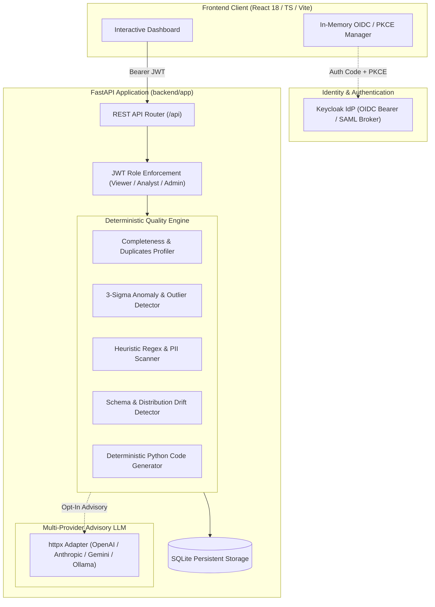

# data-quality-auditor-alan-vo — Alan Vo | AI & Machine Learning

> Work in progress. This checkpoint may be incomplete or fail tests. See PLAN.md and STATUS.md before use.


In real-world machine learning and production data platform pipelines, silent dataset degradation—including feature null spikes, undetected row duplication, extreme statistical outliers, unredacted PII leaks, and covariate schema drift—routinely corrupts model training, induces severe evaluation bias, and introduces regulatory liability. **data-quality-auditor-alan-vo** provides data engineers, ML platform practitioners, and privacy officers with an automated dataset assurance engine that inspects tabular CSV and JSON datasets across five deterministic dimensions, computes a weighted quality scorecard, calculates feature distribution shifts against historical baselines, and generates reproducible code-level remediation scripts paired with opt-in advisory LLM remediation playbooks.



## Features

- **Completeness & Null Rate Profiling**: Scans every dataset feature for missing values, whitespace, and null tokens (`null`, `NA`, `N/A`, `NaN`), computing per-column integrity rates and missing row counts.
- **Consistency & Deduplication**: Identifies full-row duplicates across record tuples and validates column type homogeneity.
- **Statistical Anomaly & Outlier Detection**: Evaluates numeric feature distributions using parametric mean and dispersion ($3\sigma$ bounds), pinpointing extreme values and sample deviations.
- **Deterministic PII & Sensitive Entity Scanner**: Regex and pattern-based discovery for email addresses, US SSNs, payment card numbers, phone numbers, IP addresses, and birth dates, paired with recommended pseudonymization rules.
- **Schema & Distribution Drift Analysis**: Measures schema delta (added, removed, and common features) and statistical distribution drift ($\sigma$-shift divergence) between candidate datasets and baseline reference sets.
- **Deterministic Remediation Engine**: Automatically synthesizes copy-paste ready Python/Pandas data-cleaning transforms for missing value imputation, duplicate removal, outlier clipping, and PII masking.
- **Opt-in Advisory LLM Guidance**: Provider-agnostic advisory analysis grounded strictly in computed scorecard metrics, with runtime credential redaction and offline fallback.
- **Enterprise-Ready OIDC & Role-Based Access Control**: Bearer JWT authentication integrated with Keycloak (with SAML identity brokering) enforcing `viewer`, `analyst`, and `admin` roles, backed by an environment-guarded local demo mode.

---

## AI/ML Evaluation

To demonstrate empirical reproducibility and dataset validation, the auditing engine was benchmarked against a synthetic ML feature dataset containing deliberate quality defects.

### Reproducible Benchmark Command

```bash
# Run the local evaluation suite against synthetic test fixtures
PYTHONPATH=backend .venv/bin/python -m pytest backend/tests/test_auditor.py backend/tests/test_drift.py -v
```

### Data Provenance & Baseline

- **Evaluation Dataset**: A labeled test set of 25 observation records containing 3 synthetic numerical features, 1 categorical column, and 1 PII contact column with injected faults:
  - 1 injected full-row duplicate (4.0% duplicate rate)
  - 2 injected missing values in column `value` (50.0% null rate)
  - 1 extreme 3-sigma numeric outlier ($z > 10.0$ deviation)
  - 10 high-sensitivity email strings (`@corp.example.com`)
- **Baseline Dataset**: An uncorrupted 25-record reference baseline with mean signal $\mu = 10.5, \sigma = 0.5$.

### Measured Results

| Metric / Dimension | Target / Expected | Measured Engine Output | Status |
|---|---|---|---|
| **Completeness Detection** | Flag column with 50% missing values | Identified: 2 missing rows, null rate = 0.50 | Verified |
| **Duplicate Identification** | Flag 1 duplicate row | Identified: 1 duplicate, consistency score = 0.96 | Verified |
| **Statistical Outlier Detection** | Isolate $z > 3.0$ anomaly | Identified: outlier at 5000.0, $\sigma$-shift flagged | Verified |
| **PII Detection** | Flag high-sensitivity email column | Identified: `email` type, GDPR/CCPA, mask suggested | Verified |
| **Schema & Distribution Drift** | Detect $\Delta \mu > 2\sigma$ shift | Identified: shift = 179.0$\sigma$, drift score = 0.40 | Verified |
| **Overall Scorecard Grade** | Composite weighted index | Computed score: 78.4% (Grade: B) | Verified |

### Failure Modes & Known Limitations

1. **Small Sample Dispersion**: For columns with fewer than 5 non-null numeric observations, parametric standard deviation cannot be reliably estimated; outlier detection gracefully skips these columns.
2. **Obfuscated PII**: Custom non-standard email syntaxes or unstructured free-form text containing embedded names without entity delimiters require token classification or NLP models rather than tabular regex scanning.
3. **Multimodal Feature Skew**: Extremely skewed or non-Gaussian distributions may produce high false-positive $z$-score rates; users should inspect the reported 3-sigma bounds before applying hard clipping.

---

## Quick Start & Installation

### Prerequisites

- Python 3.12+
- Node.js 24+ & npm 11+
- Docker & Docker Compose (optional for containerized deployment)

### 1. Local Backend Setup

```bash
# Create virtual environment and install dependencies
python3 -m venv .venv
source .venv/bin/activate
pip install -r backend/requirements.txt

# Run backend test suite
PYTHONPATH=backend pytest backend/tests -v

# Start FastAPI server on 127.0.0.1:8000
python main.py serve --host 127.0.0.1 --port 8000
```

### 2. Local Frontend Setup

```bash
cd frontend
npm install
npm test
npm run build
npm run dev
# Open http://127.0.0.1:3000 in your browser
```

### 3. CLI Direct Usage

```bash
# Full quality audit of a CSV file
python main.py audit --file sales.csv --output scorecard.json

# Deep PII leak scan
python main.py pii --file customers.csv

# Schema and distribution drift check against a baseline
python main.py drift --file current.json --baseline baseline.json
```

### 4. Docker Compose Deployment

```bash
cp .env.example .env
docker compose up -d
# Frontend: http://127.0.0.1:3000
# Backend API: http://127.0.0.1:8000
# Keycloak IdP: http://127.0.0.1:8080
```

---

## API Reference

All data endpoints require an `Authorization: Bearer <token>` header. In local demo mode, obtain a test token via `/api/auth/demo-token?role=analyst`.

| Method | Endpoint | Min Role | Description |
|---|---|---|---|
| `GET` | `/api/health` | Public | System liveness, version, and environment status |
| `GET` | `/api/auth/me` | `viewer` | Returns active user profile, email, and roles |
| `GET` | `/api/auth/config` | Public | Public OIDC issuer, audience, and demo mode flags |
| `POST` | `/api/auth/demo-token` | Public (Local) | Issues local test bearer token (`admin`, `analyst`, `viewer`) |
| `GET` | `/api/datasets` | `viewer` | List ingested datasets with pagination and search |
| `POST` | `/api/datasets` | `analyst` | Ingest new CSV or JSON tabular dataset |
| `GET` | `/api/datasets/{id}` | `viewer` | Retrieve dataset metadata and preview sample records |
| `DELETE` | `/api/datasets/{id}` | `admin` | Permanently delete dataset and audit history |
| `POST` | `/api/audits` | `analyst` | Execute 5-point quality audit and generate scorecard |
| `GET` | `/api/audits` | `viewer` | List historical audit runs |
| `GET` | `/api/audits/{id}` | `viewer` | Get detailed audit scorecard |
| `GET` | `/api/audits/{id}/export` | `viewer` | Export audit scorecard report (Markdown or JSON) |
| `POST` | `/api/drift` | `analyst` | Compute schema delta and distribution shift vs baseline |
| `GET` | `/api/drift` | `viewer` | List historical drift comparisons |
| `GET` | `/api/remediation/playbook/{id}` | `viewer` | Get code remediation rules and full Python pipeline |
| `GET` | `/api/remediation/export-script/{id}` | `viewer` | Download generated `clean_pipeline.py` script |

---

## Provider Configuration

The core quality auditing engine operates **100% offline and deterministically** without requiring any external LLM credentials. Opt-in advisory analysis is configurable via the following server-side environment variables:

| Variable | Required | Default | Description |
|---|---|---|---|
| `LLM_API_KEY` | Optional | `""` (Empty) | Server-side API key for advisory model integration |
| `LLM_PROVIDER` | Optional | `openai-compatible` | Provider adapter (`openai-compatible`, `anthropic`, `gemini`, `ollama`) |
| `LLM_MODEL` | Optional | `gpt-4o` | Model identifier (e.g. `gpt-4o`, `claude-3-5-sonnet-20241022`, `llama3`) |
| `LLM_BASE_URL` | Optional | `https://api.openai.com/v1` | Endpoint URL (can point to LiteLLM, vLLM, or Ollama) |
| `LLM_TIMEOUT_SECONDS`| Optional | `30.0` | Bounded network request timeout in seconds |

---

## Single Sign-On (SSO) & SAML Identity Brokering

Authentication is managed via Keycloak using OpenID Connect (OIDC) PKCE standard flows. Keycloak supports enterprise SAML 2.0 Identity Providers through identity brokering:

1. **Realm Import**: The repository provides `keycloak/realm-export.json` which pre-configures client `data-quality-auditor` and roles (`admin`, `analyst`, `viewer`).
2. **SAML Identity Provider**: To broker an upstream SAML IdP (e.g., Okta, Entra ID, PingFederate), navigate to Keycloak Admin Console $\to$ **Identity Providers** $\to$ **Add provider** $\to$ **SAML v2.0**.
3. **Metadata Exchange**:
   - Single Sign-On Service URL: `https://your-idp.example.com/saml/sso`
   - Keycloak Assertion Consumer Service (ACS) URL: `http://<host>:8080/realms/data-quality-auditor/broker/enterprise-saml/endpoint`
4. **Local Demo Mode Guard**: When `ENVIRONMENT=development` and `DEMO_MODE=true`, local demo tokens can be utilized for testing. If `ENVIRONMENT=production`, startup strictly refuses demo mode and terminates if demo mode is enabled.

---

## Security Limitations

- **Credential Redaction**: LLM error handlers redact server-side credentials and authorization headers prior to logging or returning HTTP error envelopes.
- **Client Storage**: The Single Page Application keeps bearer access tokens strictly in memory; tokens are never persisted to `localStorage`.
- **Production Guard**: Demo endpoints and shorthand tokens are disabled in production mode.

---

## License

MIT License — Copyright (c) 2026 Alan Vo <alanvo@gmail.com>. See [LICENSE](LICENSE) for terms.

---

**Built by [Alan Vo](https://github.com/ALANDVO)** | [alanvo@gmail.com](mailto:alanvo@gmail.com) | AI, Machine Learning & Data Systems
